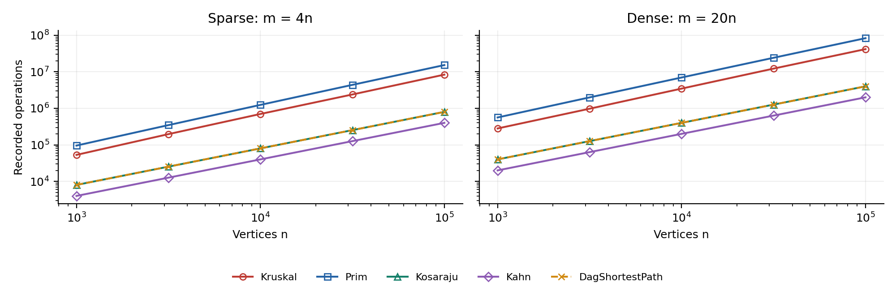
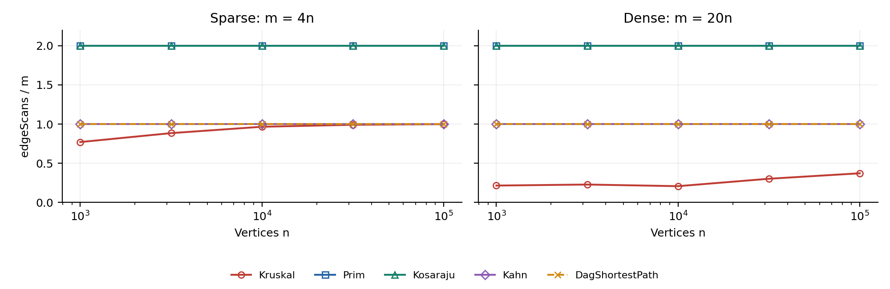
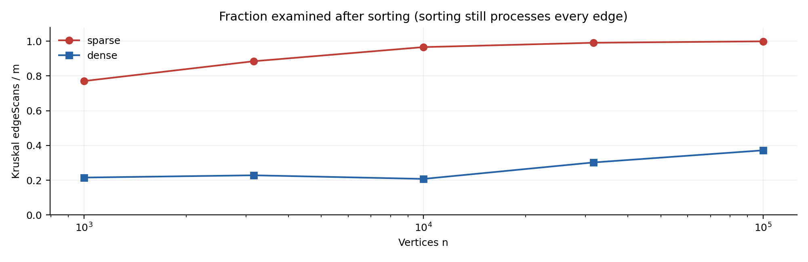

# City Network & Job Scheduler

DAA Assignment 3 | Alikhan Yerbol | SE-2517 | 21 October 2026

Repository: https://github.com/alikhanov0/daa-assignment3-graphs | branch main | release v1.0

## 1. Implementation and complexity

One adjacency-list Graph supports directed and undirected multigraphs. Logical undirected edges are stored once for Kruskal and twice in adjacency lists for Prim. Weights are int; totals and distances are long. All DFS traversals use explicit arrays as stacks. Let n=V, m=E and k be the edges Kruskal examines after sorting; logarithms below use max(2,m). Space excludes the input graph and includes auxiliary data and returned results.

| Algorithm | Time | Extra space | Reason |
| --- | --- | --- | --- |
| DSU find / union | O(alpha(n)) amortized | O(n) structure; O(1) per call | Union by size + full path compression; makeSet is O(n). A single call can take O(log n). |
| Kruskal | O(n + m log m) | O(n + m) | Stable merge sort; at most m unions, each with two finds; n-array initialization. |
| Prim (lazy heap) | O(n + m log m) | O(n + m) | Each adjacency entry scanned; up to m candidates enter the heap. Multigraphs need log m, not automatically log n. |
| Kosaraju | O(n + m) | O(n + m) | Two DFS passes and an explicit transpose; linear stacks and arrays. |
| Kahn | O(n + m) | O(n) | Copy cached indegrees, queue each vertex once, scan each outgoing edge once. |
| DAG shortest paths | O(n + m) | O(n) | Kahn order, then one relaxation pass; distance and parent arrays. |

## 2. Correctness arguments

Cut property (7 sentences). Consider a cut that respects the already chosen forest, and let e be a lightest edge crossing it. If an optimal spanning tree T omits e, adding e to T creates a cycle. That cycle contains another edge f crossing the same cut. Since w(e) <= w(f), replacing f with e preserves connectivity without increasing total weight. Thus some optimum contains the chosen forest together with e. Kruskal chooses the lightest edge joining distinct DSU components, so the cut around either component respects the forest and the exchange argument applies. Prim chooses a lightest edge leaving the visited set; restarting it in each unvisited connected component yields a minimum spanning forest, including isolated vertices.

Topological induction (7 sentences). Every source receives distance zero, equivalent to adding a virtual source with zero-weight edges to all original sources. Every vertex of a finite DAG is reachable from some source, since repeatedly following predecessors must terminate. Assume that all vertices preceding v in a topological order already have optimal distances. Any nonempty path ending at v ends with an edge u -> v, where u precedes v. Relaxing every such edge therefore considers every possible optimal predecessor and finalizes the minimum distance of v. The induction works for negative weights because an edge never returns to a finalized predecessor and no directed cycle exists. Recording the predecessor and its selected edge weight on each improvement reconstructs an actual optimal path, even with parallel edges.

---

# 3. Reproducibility and reference checks

For each of the five sizes and two densities, three separate graphs are generated with a fresh java.util.Random(42). A Fisher-Yates permutation and an interleaved random weight are used exactly as specified; rejected self-loops redraw b, and the DAG compares rank[a] with rank[b]. Parallel edges are retained. The benchmark warms up each algorithm once, measures five complete invocations, reports the median, and checks that all five counter/result signatures agree. Graph generation, result summarization and validation are outside the timed region.

| n / m | MST weight (both) | SCC count | Sum of DAG distances |
| --- | --- | --- | --- |
| 1,000 / 4,000 | 147,970 | 27 | 396,274 |
| 1,000 / 20,000 | 30,363 | 1 | 252,411 |
| 3,162 / 12,648 | 468,911 | 137 | 1,271,911 |
| 3,162 / 63,240 | 97,589 | 1 | 723,157 |
| 10,000 / 40,000 | 1,486,139 | 373 | 3,941,828 |
| 10,000 / 200,000 | 309,550 | 1 | 2,381,342 |
| 31,623 / 126,492 | 4,715,515 | 1,188 | 12,551,891 |
| 31,623 / 632,460 | 968,517 | 1 | 7,376,612 |
| 100,000 / 400,000 | 15,012,094 | 3,923 | 40,096,539 |
| 100,000 / 2,000,000 | 3,056,681 | 1 | 23,512,087 |

All 30 reference values match the assignment, both MST algorithms agree, every Kahn order is validated edge by edge, and every Tarjan partition equals Kosaraju's. results/results.csv has exactly 50 data rows; bonus_tarjan.csv has 10 separate bonus rows. Any mismatch raises an exception before the final CSV is replaced.

## 4. Counters divided by their formulas

| Algorithm | Normalization | Sparse min-max | Dense min-max |
| --- | --- | --- | --- |
| DSU in Kruskal | dsuOps / examined k | 2.250 - 2.324 | 2.134 - 2.241 |
| Kruskal | ops / (m log2 m) | 1.110 - 1.146 | 0.968 - 1.003 |
| Prim | ops / (m log2 m) | 1.997 - 2.053 | 1.967 - 1.988 |
| Kosaraju | scans / (n + m) | 1.600 - 1.600 | 1.905 - 1.905 |
| Kahn | scans / (n + m) | 0.800 - 0.800 | 0.952 - 0.952 |
| DagShortestPath | scans / (n + m) | 0.800 - 0.800 | 0.952 - 0.952 |

Here ops = dsu_ops + edge_scans + comparisons, a declared proxy rather than a literal CPU instruction count. The bounded MST ratios support the sorting/heap growth model; traversal ratios are exactly constant because m=4n or 20n. DSU uses two find calls per examined edge and one counted union only when successful, hence dsuOps = 2k + (n-c), where c is the final component count. dsuOps/k remains bounded; dsuOps/m need not stay constant when early stopping changes k/m. Counting calls alone cannot establish the inverse-Ackermann bound: that bound follows from the two DSU heuristics.

---

# 5. Operation growth and slope checks

Figure 1. One series per algorithm and density on log-log axes. Kosaraju and DAG operations overlap at 2m; they count different operations.

Figure 2. Prim and Kosaraju overlap at 2 scans/edge; Kahn and DAG relaxation overlap at 1. Kruskal scans only its examined prefix.

| Algorithm | Scans slope sparse | Scans slope dense | Ops slope sparse | Ops slope dense |
| --- | --- | --- | --- | --- |
| Kruskal | 1.055 | 1.119 | 1.096 | 1.088 |
| Prim | 1.000 | 1.000 | 1.102 | 1.085 |
| Kosaraju | 1.000 | 1.000 | 1.000 | 1.000 |
| Kahn | 1.000 | 1.000 | 1.000 | 1.000 |
| DagShortestPath | 1.000 | 1.000 | 1.000 | 1.000 |

Slopes use ordinary least squares of ln(counter) on ln(n), independently for each density and all five sizes. Traversal edge-scan slopes are exactly 1.000. Kruskal's sorting-comparison slopes are 1.105 (sparse), 1.087 (dense). These finite-range slopes are slightly above one, consistent with m log m; they approach one asymptotically and are not fixed polynomial exponents.

Specification clarification: an E log E sort does not make Kruskal's edgeScans count E log E. Every sorted edge is considered at most once; comparisons measure the sorting cost separately. The scan slopes above reflect a changing examined fraction, not the logarithmic factor. Reporting comparisons and total recorded operations avoids claiming evidence that the scan counter cannot provide.

---

# 6. Choosing an algorithm

Figure 3. Early termination saves DSU scans after a spanning tree is complete, but does not remove the initial sort.

At n=100,000, Kruskal examines 99.92% of sparse edges; 37.18% of dense edges. Sparse graphs require nearly all sorted edges, while dense graphs offer many alternatives and a shorter relative prefix. Our lazy Prim scans 2m adjacency entries and drains its candidate heap, including stale entries. Kruskal performs fewer recorded operations for every supplied case; this is evidence about these implementations and graph families, not a universal winner.

| Situation | Choice | Why / limitation |
| --- | --- | --- |
| Sparse undirected graph; edge list | Kruskal | Sorting plus DSU is simple; no adjacency heap is required. |
| Undirected adjacency lists, connected or not | Prim or Kruskal | Prim grows locally; restart for disconnected components. Compare actual heap and sorting work. |
| Truly dense simple graph, m=Theta(n^2) | Matrix Prim (alternative) | O(n^2) array/matrix implementation avoids heap logs; our required version uses a PriorityQueue. m=20n is only relatively dense. |
| Directed graph, cycles possible | Kosaraju / Tarjan | Identify SCCs and deadlocks; Tarjan saves a pass and transpose storage. |
| Dependency order, cycle status unknown | Kahn | Returns a complete valid order or explicitly reports a cycle. |
| DAG, even with negative weights | DAG shortest paths | Topological relaxation is linear; all sources are initialized to zero. |
| General graph shortest routes | Dijkstra / Bellman-Ford | Nonnegative edges: Dijkstra. Negative edges: Bellman-Ford and negative-cycle handling (outside this project). |

## Measured time is secondary evidence

On the recorded Windows 11 amd64 / Java 19.0.2 run with a 2.0 GiB heap, the largest sparse/dense median times in milliseconds were: Kruskal 219.9/1268.3; Prim 396.8/3075.7; Kosaraju 245.2/796.3; Kahn 61.9/220.2; DagShortestPath 96.9/291.9. The two smallest sizes are vulnerable to JIT, allocation and scheduling noise; one warm-up is not a full JVM benchmarking harness. Five-run medians reduce outliers, but other hardware, JVMs, garbage collection and background load change the clock. Counter trends are the graded evidence; timing does not justify a universal claim that one algorithm is always faster.

---

# 7. Bonus algorithms and validation

## Tarjan: one DFS pass

The iterative Tarjan implementation maintains discovery index[], low[], a DFS frame stack and a stack of active vertices. A completed DFS child propagates its low-link value to its parent; an edge to an active discovered vertex uses that vertex's discovery index. A vertex with low[v]=index[v] closes exactly one SCC, popped from the active stack. Finished SCCs are ignored in later low-link updates. The algorithm takes O(n+m) time and O(n) auxiliary space, excluding the input and output. It performs exactly m traversal scans versus Kosaraju's 2m, saving 50% of traversal edge inspections and avoiding the transpose; counting transpose construction too changes 3m versus m. At n=100,000 and m=2,000,000 the measured counts are 2,000,000 and 4,000,000, respectively.

## Condensation and critical path

Each SCC becomes one vertex. Every original inter-component edge keeps its weight; parallel inter-component edges are retained and intra-component edges are omitted. A directed cycle among condensed vertices would make those components mutually reachable, contradicting that they are different SCCs, so condensation is always a DAG. Longest paths use the same topological induction with maximum instead of minimum, avoiding int negation overflow; all zero-indegree components start at zero. This is equivalent to negating weights, solving shortest paths and negating distances, with appropriate long arithmetic. The cyclic fixture yields four components, two inter-component edges and a critical path of weight 13. This is a path through components, not a solution to longest simple paths inside an original SCC; internal durations need an explicit model.

In scheduling, a critical path determines the earliest possible completion time when edge weights model nonnegative activity durations and predecessor constraints must hold. Arbitrary negative weights remain mathematically valid in DAG path calculations, although they are not normal durations. In general graphs, unrestricted longest walks can be unbounded because of positive cycles, while longest simple path is NP-hard. Negative weights are likewise safe for DAG shortest paths because no negative cycle exists; in general graphs a reachable negative cycle destroys a finite shortest-walk optimum, and negative edges alone already invalidate Dijkstra's greedy rule.

## Tests and counter accounting

JUnit 5 passes 15 test methods with no failures: 1,000 random DSU unions checked against set labels; 100 connected MST instances; 100 tiny forests checked by exhaustive edge subsets; 100 SCC instances up to 200 vertices checked by BFS in both directions; 150 random DAGs with negative and parallel edges checked against Bellman-Ford, for both shortest and longest paths; 100 random condensations; malformed files and four committed fixtures; overflow, empty, isolated, loop and cycle cases; 100,000-vertex path AND cycle with a 256 KiB JVM stack. Both SCC algorithms survive, and reconstructed paths are checked edge by edge with their selected weights.

Counter contract: findCalls counts public find invocations; successfulUnions counts only merges; comparisons counts merge-sort/heap weight comparisons and DAG candidate-distance comparisons, not vertex IDs. maxDepth is the maximum explicit DFS frame depth for Kosaraju; for Tarjan it is the larger of the frame and active-stack maxima, not their sum. Queue size is not DFS depth. CSV edge_scans records traversal/relaxation work: Kosaraju 2m, Kahn m, DAG relaxation m. Transpose construction and DAG's internal Kahn preparation are instrumented separately in preparationEdgeScans (m each), excluded from the prescribed CSV columns but included in timings. Cached indegrees are maintained when edges are added.

## Reproduction and specification decisions

Run mvn clean verify, java -Xmx2g -jar target/assignment3-graphs.jar benchmark, then python scripts/report.py; scripts/reproduce.ps1 and scripts/reproduce.sh combine these steps. The report and charts are regenerated from the resulting CSV. Source requires JDK 17+; Python is needed only to regenerate the report. Follow the explicit ten size/density pairs and 50-row requirement; the deliverables' phrase 'four generated graphs' is inconsistent with those detailed instructions. README documents AI assistance, commands, repository and release. Git contains main, the five requested feature branches and v1.0, with incremental implementation/test commits.
